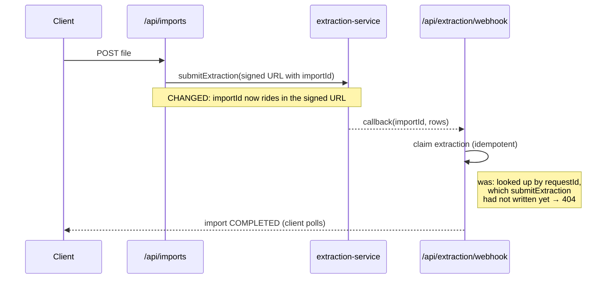
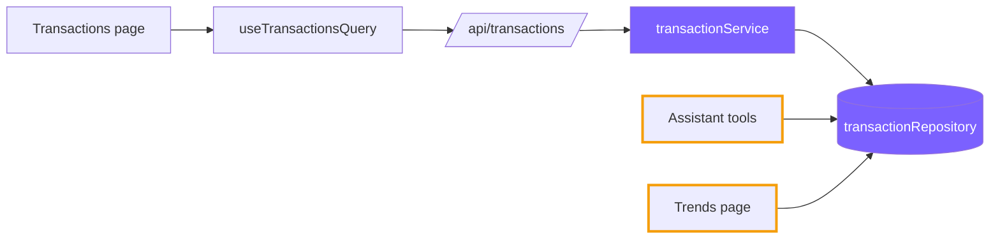

# Visualization — the flow before and after

Inside Reviewer details, after Implementation, draw the affected components **twice**: the flow as it runs on the base branch, and as it runs with this PR. Required in the full structure — the pair answers "what moved, and what now happens where" before the reviewer opens a file. GitHub renders Mermaid in PR bodies, so the diagrams live in the description itself, with no image to commit, and stay readable in both themes.

````markdown
## Visualization

**Before**
```mermaid
...the base branch's flow...
```

**After**
```mermaid
...the same components with this PR...
```

<one line: what to take from the difference>
````

- **Same components, same layout, in both.** The reader diffs the two pictures by eye; a node that moves or is renamed between them reads as a change. Add or remove only what the PR adds or removes.
- **Mark the change in the After diagram**: fill the touched nodes, and outline nodes not touched but reading the same code (Blast radius, below). In a sequence diagram, a `Note` on the new step does the same job.
- **Draw only what this PR touches plus one hop either side.** In a stack, the "before" is the PR's own base: a bottom PR that adds an uncalled module shows the module standing alone after, with nothing calling it yet. Saying so is the point.
- **A local change still gets the pair**, just small: three or four nodes showing the one step that behaves differently. Twelve nodes per diagram is the ceiling.

Pick the diagram type by the question:

### Async flows — sequence diagram

Show the ordering, and mark what this PR changed. The point is the race, not the happy path:

````markdown

````

`Note` is doing the real work — it marks the edit and states the failure it removes. A sequence diagram that only shows the new happy path tells the reviewer nothing about why the PR exists.

### Blast radius — flowchart

When the question is *what else is affected*, draw the components and highlight the touched ones:

````markdown

````

Filled = changed by this PR. Outlined = **not** changed but reading the same code, so a reviewer sees immediately that the assistant and the trends page inherit the new behaviour. That second category is the one worth drawing — it is how a "small" change turns out to be critical.

Caption the pair with one line saying what to take from the difference. Keep each to a dozen nodes; past that it stops being a glance.
